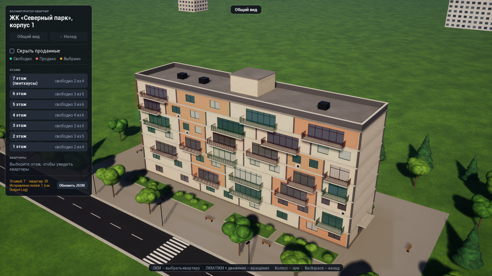
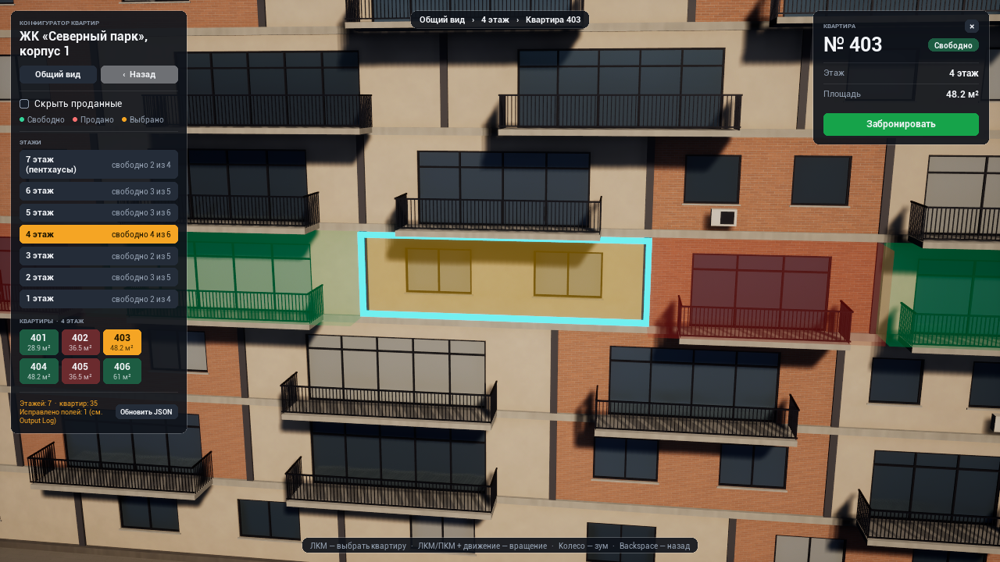
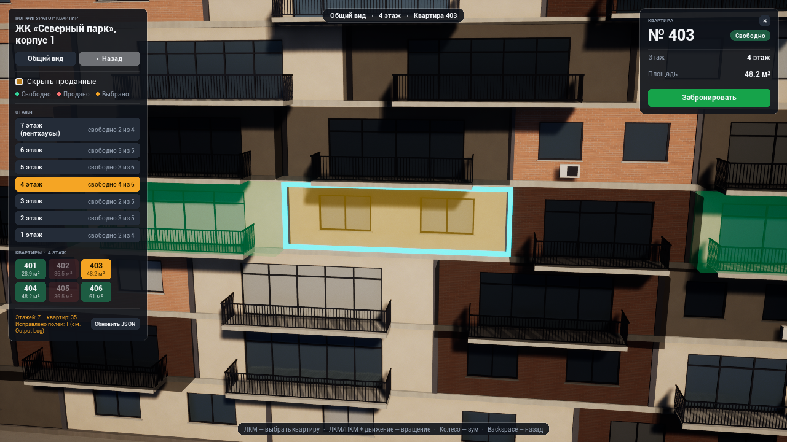

# ApartmentConfigurator

Конфигуратор этажей и квартир на Unreal Engine 5.7, C++.

Что есть: здание строится по JSON, у камеры три режима (общий вид, этаж, квартира) с плавными перелётами и кнопкой "Назад", панель этажей генерируется из данных, по клику на квартиру открывается карточка с кнопкой бронирования, есть фильтр "Скрыть проданные".

| Общий вид | Выбранная квартира | Фильтр "Скрыть проданные" |
|---|---|---|
|  |  |  |

## Запуск

Нужен UE 5.7 и Visual Studio 2022/2026 с C++. Собирал и проверял на 5.7.4.

1. Открыть `ApartmentConfigurator.uproject`. В `Binaries/Win64` лежат собранные dll под 5.7.4, так что на этой версии ничего компилировать не нужно. На другой версии движок сам предложит пересобрать модули.
2. Нажать Play.

Уровень используется стандартный, `Template_Default` из движка, GameMode прописан в `DefaultEngine.ini`. Дом, окружение, камера и UI спавнятся из кода, на уровне ничего расставлять не надо. Если вдруг в вашей сборке этой карты нет, можно создать пустой Basic-уровень и указать его в Maps & Modes.

Управление:
- ЛКМ по квартире на фасаде (или кнопка квартиры в панели) - выбрать квартиру
- ЛКМ или ПКМ + движение мыши - вращать камеру, колесо - зум
- Backspace или кнопка "Назад" - шаг назад
- "Обновить JSON" - перечитать файл с данными

Данные лежат в `Content/Data/Building.json`. Путь можно поменять без пересборки в Project Settings > Game > Configurator Data. Там же есть `SimulatedLoadDelaySeconds`, искусственная задержка загрузки: удобно посмотреть, что файл грузится в фоне и интерфейс в это время не подвисает.

Проверить устойчивость парсера можно прямо в игре через консоль (`~`):

```
Configurator.Load Data/Building_Messy.json    файл с кучей битых полей, грузится с исправлениями
Configurator.Load Data/Building_Broken.json   сломанный синтаксис, файл отклоняется, остаются старые данные
Configurator.Load                             вернуть основной файл
```

## Архитектура

Проект разбит на два модуля:

- `ConfiguratorData` - всё, что касается данных: структуры, парсер JSON, загрузка. Про сцену, камеру и UI этот модуль ничего не знает.
- `ApartmentConfigurator` - игровой модуль: состояние навигации, камера, здание, ввод, интерфейс.

Зависимость в одну сторону. Данные вынес отдельно, чтобы парсер можно было тестировать без сцены (его тесты лежат там же) и чтобы игровой код не расползался по работе с данными.

### Данные

`UApartmentDataSubsystem` (GameInstanceSubsystem) загружает и хранит данные здания. GameInstance выбрал потому, что данные нужны всё время работы приложения и не должны пересоздаваться вместе с уровнем. Плюс подсистему движок создаёт сам, не нужен ни синглтон, ни актор-менеджер на сцене. Кроме самих данных там хранится мапа ID -> (этаж, квартира), чтобы по клику быстро находить квартиру.

Загрузка идёт в фоне: файл читается и парсится в пуле потоков, на выходе обычные структуры без UObject. Результат возвращается на game thread через `AsyncTask` и слабый указатель. Если пока файл грузится пришёл новый запрос, старый результат просто выбрасывается.

Парсер (`FConfiguratorJsonParser`) специально сделан "терпимым": падать он не должен ни на каком входе.
- Если сломан сам JSON (синтаксис, пустой файл, нет массива этажей), файл отклоняется целиком, остаются прежние данные, ошибка пишется в лог и показывается в панели.
- Если что-то не так с отдельными полями, запись исправляется или пропускается с предупреждением. Нет id - генерирую, дубликат id - переименовываю, неизвестный статус - квартира помечается как неизвестная (серая, бронировать нельзя). Площадь можно указать строкой (`"54,3"`), кривая площадь считается "не указанной". Нет точки фокуса - камера смотрит на центр квартиры.
- Есть лимиты на размер файла и количество этажей и квартир, чтобы огромный файл не повесил приложение.

Формат:

```json
{
  "building": "ЖК «Северный парк», корпус 1",
  "floors": [
    { "number": 1, "name": "1 этаж", "apartments": [
      { "id": "101", "status": "Продано", "area": 38.2, "focusPoint": { "x": -2066, "y": -660, "z": 172.5 } }
    ] }
  ]
}
```

`focusPoint` - точка, куда смотрит камера в режиме квартиры, в локальных координатах здания (см). Статус понимается как "Продано"/"Свободно" (и пара вариантов написания, включая английские).

### Состояние и связь между частями

`UConfiguratorStateSubsystem` (WorldSubsystem) хранит, что сейчас выбрано: режим камеры, этаж, квартиру, фильтр и историю для кнопки "Назад". Сделал его WorldSubsystem, потому что это состояние конкретного уровня и оно должно умирать вместе с ним.

Все остальные части работают с ним одинаково. UI и клик по сцене вызывают команды (`ShowFloor`, `ShowApartment`, `GoBack`, `SetHideSold`), а камера, здание и HUD подписаны на события `OnViewChanged` и `OnFilterChanged`. Друг о друге они не знают. За счёт этого клик по квартире в 3D и клик по кнопке в панели проходят один и тот же путь, ничего не дублируется.

В истории храню не указатели, а индекс этажа и ID квартиры, поэтому после перезагрузки JSON ничего не ломается. Фильтр в историю не пишется: это настройка отображения, а не переход.

### Камера

`UOrbitCameraComponent` отвечает только за движение: точка фокуса, yaw, pitch, дистанция и переходы между ними. Интерполирую именно эти параметры, а не трансформ камеры, поэтому во время перелёта камера всё время смотрит на цель. Сглаживание smootherstep, дистанция меняется в логарифмическом масштабе (при линейной в конце приближения заметен рывок), длительность перелёта зависит от расстояния. Тик у компонента включается только на время анимации.

`AConfiguratorCameraPawn` решает, куда лететь: для каждого режима свой ракурс, дистанция подбирается так, чтобы объект целиком влезал в кадр. Пешка, а не отдельный CameraActor, потому что так проще с вводом и view target.

Как устроено здание, камера не знает. Габариты этажей и точки фокуса она получает через интерфейс `IConfiguratorSceneProvider`, так что если заменить процедурный дом на настоящую модель, камеру менять не придётся.

### Здание

`FBuildingPlan` - раскладка здания, считается один раз по данным: все этажи одной ширины, квартиры делят этаж пропорционально площади, у части квартир балконы. По этому плану строится и сам дом, и кликабельные объёмы квартир, и габариты для камеры, поэтому они не могут друг с другом разъехаться.

`UBuildingArchitectureComponent` строит "коробку" дома: стены с проёмами, окна с рамами, балконы, кровлю. Всё это инстансы одного куба, по одному ISM-компоненту на материал, выходит около 9 draw call на весь дом. Коллизии у этой геометрии нет.

`UApartmentMeshComponent` - квартира на сцене: полупрозрачный объём поверх фасада. Он же подсвечивает статус и он же ловит клик, так что клик по окну или балкону попадает в нужную квартиру. Сделал компонентом, а не актором, потому что своей логики у квартиры нет. Контур выбранной квартиры один на всё здание (`UBoxOutlineComponent`), он просто переставляется.

Вокруг дома `AConfiguratorSiteActor` (газон, дорога, деревья, постпроцесс). Это чистый декор, к логике он отношения не имеет.

Ассетов в проекте всего два, это материалы, и те генерируются скриптом `Tools/CreateMaterials.py`. Фактуры (кирпич, штукатурка, плитка и т.д.) считаются в шейдере, текстур нет. Пересоздать материалы (с закрытым редактором):

```
UnrealEditor-Cmd.exe ApartmentConfigurator.uproject -run=pythonscript -script="<путь>/Tools/CreateMaterials.py"
```

### Интерфейс

UI собран в C++ (`UUserWidget` + `WidgetTree->ConstructWidget`), без WBP-ассетов, чтобы весь интерфейс был виден в коде. HUD сам ничего не решает: отправляет команды в state subsystem и перерисовывается по событиям, причём точечно. Список квартир пересоздаётся только при смене этажа, выбор и фильтр - это просто смена цвета и доступности кнопок.

У `UButton::OnClicked` нет параметров, поэтому для кнопок, созданных по данным, сделал `UConfiguratorListButton`: она хранит индекс этажа или ID квартиры. Цвета и стили кнопок собраны в одном месте, в `ConfiguratorUIStyle`.

### Ввод

`AConfiguratorPlayerController`: Enhanced Input, действия и mapping context создаются в коде (при желании их можно заменить ассетами в свойствах контроллера). Клик от перетаскивания отличаю по порогу в пикселях, трассировка делается только по клику, не каждый кадр.

Из граблей: движок по умолчанию умножает оси мыши на 0.07 (`BaseInput.ini`), и вращение камеры было раз в десять медленнее, чем я рассчитывал. Переопределил это в `Config/DefaultInput.ini`.

## Производительность

- Тик выключен у всех акторов и виджетов, кроме камеры во время перелёта.
- Всё обновляется по событиям. При смене вида или фильтра подсветка перекрашивает только те квартиры, у которых что-то поменялось.
- Дом и окружение на инстансах.
- Освещение полностью динамическое (Lumen), запекать тут нечего, дом строится в рантайме. Virtual Shadow Maps выключил: у меня на GTX 1650 с ними редактор падал с `DXGI_ERROR_DEVICE_HUNG`, а разница на этой сцене почти не видна. На той же 1650 выходит 50-60 fps в окне 1280x720.

## Тесты

Автотесты лежат в проекте:

- `Configurator.Data.*` - парсер: нормальный файл, битые поля, битый и пустой JSON.
- `Configurator.Game.Smoke` - сценарий в запущенной игре: общий вид, этаж, квартира, фильтр, "Назад", перезагрузка JSON (включая битые файлы). По ходу сохраняет скриншоты в `Saved/Screenshots`.
- `Configurator.Game.Input` - то же через реальный ввод: события мыши и клавиатуры подаются в Slate, как от настоящих устройств. Клик по кнопке этажа, клик по квартире на фасаде, бронирование, колесо, вращение, фильтр, Backspace. Пока он идёт, мышь лучше не трогать.

Запуск:

```
UnrealEditor-Cmd.exe ApartmentConfigurator.uproject -nullrhi -ExecCmds="Automation RunTests Configurator.Data" -testexit="Automation Test Queue Empty"
UnrealEditor.exe ApartmentConfigurator.uproject -game -windowed -ExecCmds="Automation RunTests Configurator.Game" -testexit="Automation Test Queue Empty"
```

## Что бы доделал

- Настоящую модель здания вместо процедурной, через тот же `IConfiguratorSceneProvider`.
- Контур выделения через Custom Depth вместо геометрии и подсветку квартиры при наведении.
- Ассеты для Enhanced Input и WBP-наследники для UI, чтобы с ними могли работать дизайнеры.
